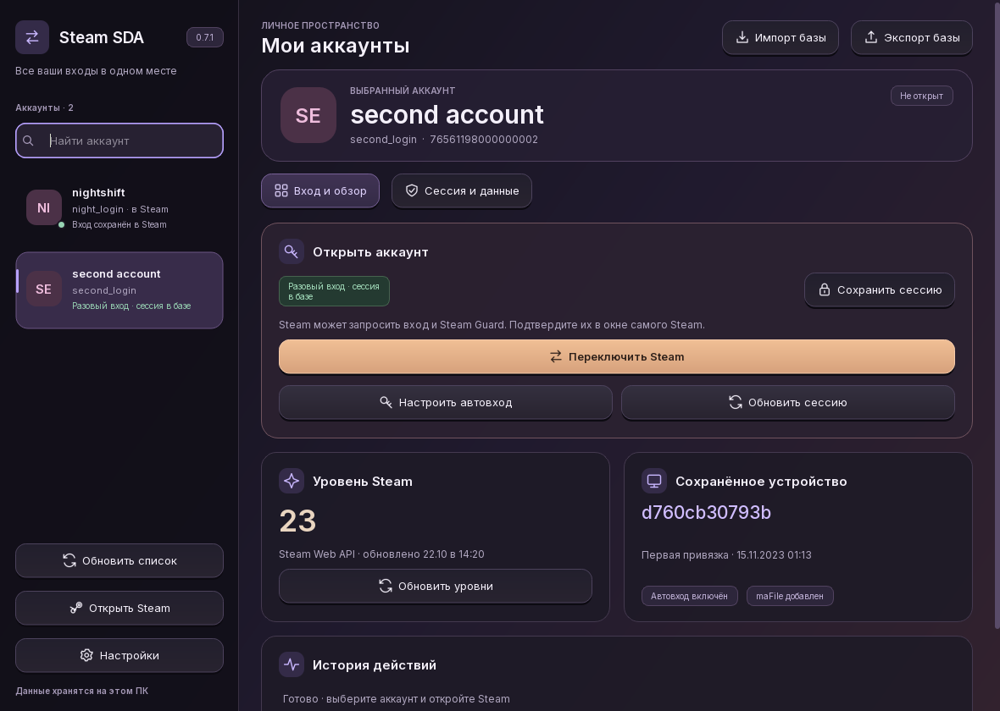

# Steam Switcher

[](https://github.com/fabbiodev/steam-switcher/actions/workflows/release.yml)
[](https://github.com/fabbiodev/steam-switcher/releases/latest)
[](LICENSE)

Приложение Windows для просмотра уровня Steam, переключения аккаунтов и автоматического
восстановления входа через SteamKit2 3.4.0. Текущая версия — 0.7.6.

В интерфейсе приложение называется **Steam SDA**.



## Скачать

Откройте [Releases](https://github.com/fabbiodev/steam-switcher/releases/latest),
скачайте `SteamSwitcher-v0.7.6-Setup-x64.exe` и запустите установщик.
При обновлении он сам определяет папку зарегистрированной установки, включая
выбранную пользователем. Для готовой сборки Python и .NET устанавливать не нужно.
Переносимый вариант — `SteamSwitcher-v0.7.6-win-x64.zip`: распакуйте всю папку
и запустите `SteamSDA.exe`. Контрольные суммы обоих файлов — в `SHA256SUMS.txt`.

Кнопка «Обновления» в приложении проверяет новые выпуски и позволяет скачать
и установить обновление с проверкой SHA-256. Фоновая проверка раз в сутки включена
по умолчанию и отключается в этом окне. После установки Steam SDA открывается снова.
Аккаунты и HWID сохраняются. Подробности — в [инструкции](docs/updates.md).

На скриншоте показаны вымышленные аккаунты.

## Запуск

Запустите `start.cmd`. Если рядом есть собранная версия, откроется
`dist/SteamSDA/SteamSDA.exe`.

Для запуска из исходников нужны Python 3.11 или новее и зависимости:

```powershell
py -3 -m venv .venv
.\.venv\Scripts\python.exe -m pip install -r requirements.txt
.\.venv\Scripts\python.exe main.py
```

## Использование

1. Steam SDA автоматически определяет установленный Steam и читает сохранённые аккаунты.
2. Выберите аккаунт слева. Поиск работает по нику, логину и SteamID.
3. Уровень загружается со страницы Steam Community. Свой Steam Web API key можно
   добавить в настройках; ключ защищается Windows DPAPI.
4. Нажмите «Переключить Steam». Приложение штатно завершит клиент, выберет аккаунт
   в его списке сохранённых входов и откроет Steam. Запущенные игры сначала нужно закрыть.

Для обычного переключения можно войти в аккаунт через сам Steam с включённой опцией
«Запомнить меня», затем обновите список в Steam SDA. Пароль и Steam Guard,
если Steam их потребует, вводятся в окне Steam.

Открытие клиента не считается успешным входом: приложение проверяет активный
SteamID через реестр и журнал авторизации текущего процесса Steam. При незавершённом
входе доступна кнопка «Вернуть прежний вход».

## Интерфейс и удаление аккаунта

В боковой панели находятся библиотека и поиск аккаунтов. «Импорт базы» и
«Экспорт базы» вынесены в верхнюю панель. На вкладке «Вход и обзор» главное
действие входа расположено перед уровнем и сохранённым устройством. На вкладке
«Сессия и данные» находятся сведения о сессии, профиль Steam, копирование SteamID
и кнопка «Удалить аккаунт». Удаление требует подтверждения с именем аккаунта.
Оно очищает локальные пароль, токены, maFile и HWID, а также кэш уровня.
Аккаунт больше не появляется при обновлении списка. Для добавления используйте импорт.
Сам аккаунт Steam, текущий вход в клиенте и исходные файлы остаются на месте.

Горячие клавиши: `Ctrl+K` — поиск, `Ctrl+I` — импорт, `Ctrl+E` — экспорт,
`Ctrl+R` — обновление списка. Тёмный фон использует градиент; кнопки реагируют
на наведение и нажатие. Палитра использует графит, фиолетовый и тёплый акцент
главного действия. Строки списка появляются с небольшим сдвигом, колесо мыши
прокручивает библиотеку плавно; выбор применяется сразу. Описание палитры,
компонентов и движения — в [дизайн-системе](docs/design-system.md).

Подсветка строк плавно переходит между аккаунтами. Поиск и поля диалогов
подсвечиваются при наведении и фокусе; вкладки, кнопки, флажки и полосы прокрутки
показывают интерактивное состояние.

В компактных строках слева видны аватар, имя, логин, статус сессии и `LVL` Steam.
Высота строки — 72 px. Обновление уровня и аватара сохраняет прокрутку и выбор
и не запускает появление списка повторно. Аватары загружаются в фоне из публичного
профиля Steam и кэшируются в `%APPDATA%\SteamSDA\avatars`. Если картинка недоступна,
остаются инициалы; неизвестный уровень обозначается `LVL —`.

## Вход без «Запомнить меня»

Разовые входы видны в списке и карточке аккаунта. Если текущий аккаунт отсутствует
в `loginusers.vdf`, программа может показать его по подтверждённому активному
SteamID и соответствию логина в `config.vdf`.

Доступный клиентский токен текущего разового входа сохраняется в защищённую базу
при обнаружении. Кнопка «Сохранить сессию» повторяет сохранение выбранного аккаунта
без закрытия Steam. Перед переключением сохраняются доступные токены выбранного
аккаунта и текущего разового входа — до того, как Steam очистит свой кэш.
Сохранённая запись остаётся видимой после закрытия клиента и включается в общий ZIP
вместе с HWID. В списке видно, сохранена ли сессия в базе.

Наличие текущего входа само по себе не даёт переносимого токена. Если Steam
не оставил подходящий токен или уже удалил его, программа показывает это явно.
Для создания сохраняемой сессии используйте «Настроить автовход» с паролем или
действующей сессией maFile. Сервер Steam проверяет токен при восстановлении входа;
сохранение файла не продлевает его срок и не отменяет отзыв.

## Автовход и обновление сессии через SteamKit

1. Нажмите «Импорт базы» и выберите `.maFile`. Программа проверит SteamID, логин и
   владельца токенов. Секреты сохраняются в защищённом хранилище Windows.
2. Если у этого аккаунта уже есть сохранённый вход в Steam на данном компьютере,
   программа может использовать его клиентский токен. Читается только выбранный аккаунт.
3. С действующей мобильной сессией maFile SteamKit создаёт собственную сессию
   авторизации, подтверждает её этим аутентификатором и получает клиентский токен.
   Сканировать QR вручную не требуется; сторонние QR не принимаются.
4. Если действующих токенов нет, откройте «Настроить автовход» и укажите пароль.
   Код мобильного Steam Guard программа получит из `shared_secret` maFile.
   Пароль по умолчанию используется один раз. Для повторного входа после отзыва
   всех токенов его можно сохранить отдельной галочкой с защитой Windows DPAPI.
5. Включённый автовход проверяет и обновляет сессию каждый час. Если до окончания
   клиентского токена осталось менее семи дней и есть подходящие данные,
   программа получает новый токен повторной авторизацией. Неограниченный срок не обещается:
   окончательное решение о выдаче и отзыве токенов принимает Steam.
6. «Переключить Steam» передаст проверенный клиентский токен настольному клиенту.
   При потере текущего входа программа подождёт 15 секунд на переподключение,
   затем попробует восстановление. Самостоятельное закрытие Steam не запускает его обратно.

`shared_secret` даёт коды Guard, но сам по себе не заменяет пароль или действующую
мобильную сессию. Старый maFile без токенов тоже импортируется; для полноценного
автовхода понадобятся действующие данные. Если Steam отклонил пароль или Guard,
автовход отключается до исправления настроек, чтобы не повторять неверные попытки.
Код из письма и дополнительные проверки Steam автоматически не обходятся.

Во время запущенной игры обновление и переключение откладываются. Интерфейс показывает
срок токена по его данным и время последней успешной проверки сервером. Пароли и
токены передаются модулю SteamKit через приватный канал процесса, без аргументов командной строки.

## Импорт и экспорт всей базы

При первом появлении аккаунта в Steam SDA программа сохраняет профиль устройства
текущего компьютера по SteamID: MachineGuid, все 16 байт сетевого компонента,
строку идентификации системного диска, hostname и FQDN. Профиль находится в
`accounts-vault.dpapi` с защитой Windows DPAPI. В карточке видны дата первой
привязки и короткий отпечаток. Повторный импорт и обновление токенов его не заменяют.

Профиль используется и для сохранённой сессии, и для входа с maFile через SteamKit.
Запуск выбранного аккаунта создаёт Steam с приостановленным основным потоком,
загружает модуль устройства, устанавливает и проверяет шесть хуков и только затем
продолжает работу клиента. При возврате прежнего входа используется профиль прежнего
аккаунта. Реестр MachineGuid и идентификаторы оборудования Windows не меняются.

Старый maFile или токен не содержит исходный HWID компьютера: для существующих
аккаунтов без профиля первая привязка происходит на компьютере, где новая версия
Steam SDA впервые увидела аккаунт. Исходный maFile остаётся без изменений. Для
переноса уже сохранённого HWID используйте ZIP Steam SDA с данными входа — профиль
включается в него вместе с сессией и maFile. Экспорт только метаданных профиль
устройства не включает.

Нативный модуль привязан к проверенным SHA-256 конкретных `steamclient64.dll` и
`tier0_s64.dll`; сведения о них находятся в `integrations/device/ABI.json`. При обновлении Steam
до неподдерживаемой сборки переключение останавливается до закрытия клиента.
Сохранённый профиль не сбрасывается. Автоматические перезапуски клиента самим Steam
и запуск через сторонний ярлык не сохраняют установленные в процессе хуки.
Смена PID не считается подтверждённым запуском с HWID. Если выбранный аккаунт уже
открыт обычным способом, кнопка «Перезапустить с HWID» применяет сохранённую привязку.
Проверка хуков до продолжения основного потока не является доказательством того,
что сервер получил именно этот machine_id: реальная авторизация проверяется отдельно.

«Экспорт базы» сохраняет все аккаунты одним ZIP: записи Steam и импортированные
аккаунты, их доступные клиентские сессии, maFile и профили HWID. Поиск и выбранная
карточка не ограничивают экспорт. Удалённые из базы аккаунты не включаются.
«Импорт базы» принимает общий ZIP, старый ZIP одного аккаунта или maFile.
Все записи архива проверяются до единой записи в хранилище; ошибочный аккаунт
останавливает весь импорт. Уже сохранённый профиль первой привязки сохраняется.

Пароль архива необязателен:
пустое поле сохраняет ZIP без шифрования, любой непустой пароль включает AES-256.
Ограничений на минимальную длину пароля нет. В окне экспорта указан выбранный
режим защиты. Пароль Steam никогда не включается в экспорт.
Для каждого экспортируемого аккаунта программа проверяет только соответствующую
ему запись локального кэша Steam и предпочитает актуальный клиентский токен.

Импорт не удаляет другие аккаунты и не заменяет уже сохранённую рабочую сессию.
Импортированный ZIP не включает автовход сам: включите его в настройках аккаунта.
Архив читается в памяти без распаковки произвольных путей на диск. Исходный maFile
не изменяется. Архив с секретами позволяет войти в аккаунт — передавайте его только
тому, кому предназначен доступ.

## Данные и восстановление

Steam SDA хранит свой кэш и настройки в `%APPDATA%\SteamSDA`.
`accounts-vault.dpapi` содержит импортированные maFile, токены и явно сохранённые
пароли. `api-key.dpapi` содержит защищённый API-ключ. `switch-recovery.dpapi` — временную
защищённую копию выбора аккаунта для восстановления при ошибке или закрытии процесса.
Файлы DPAPI привязаны к текущему пользователю Windows.

Переключение меняет `MostRecent` и `AutoLogin` в `Steam/config/loginusers.vdf` и значение
`HKCU\Software\Valve\Steam\AutoLoginUser`. Для уже запомненного аккаунта также
включается штатный параметр Steam `RememberPassword`; прежнее значение попадает
в запись восстановления. Настройка `AlwaysShowUserChooser` отключается, чтобы Steam
сразу использовал выбранный вход; при ошибке возвращается прежнее значение.
При авторизации через SteamKit также обновляется только запись выбранного аккаунта
в `%LOCALAPPDATA%\Steam\local.vdf` с штатной защитой DPAPI. Прежняя запись попадает
в защищённый журнал восстановления. Остальные аккаунты и сохранения игр не заменяются.
Перед запуском также создаётся соответствие логина и SteamID в
`config.vdf → Software → Valve → Steam → Accounts`. Без этой записи на новом ПК
клиент может отклонить токен, работающий через SteamKit. Восстановление возвращает
прежнее значение только этой записи и сохраняет остальные настройки.

Если Steam ограничил запросы уровня, приложение выдерживает указанную паузу.
Сохранённый уровень остаётся виден с пояснением ошибки. Закрытый профиль или
изменившаяся страница не превращаются в нулевой уровень.

## Архитектура

Код разделён на `domain`, `application`, `infrastructure` и `presentation/qt`.
Сценарии получают адаптеры через `bootstrap.py`; проекты .NET и C++ находятся
в `integrations/`. Карта папок и правила зависимостей описаны в
[docs/architecture.md](docs/architecture.md).

## Проверки

```powershell
python -m unittest discover -s tests -v
python main.py --check-ui ui-check.json
```

Проверка `--check-ui` использует вымышленные аккаунты и не переключает установленный Steam.
`tools/verify_live_switch.py --run` — отдельная ручная проверка реального переключения
и возврата на исходный аккаунт. Она перезапускает Steam и требует закрытых игр.

`tools/verify_vm_transfer.py --run --steam-id <SteamID> --archive <ZIP> --report <JSON>`
проверяет перенос выбранного аккаунта на Windows VM. Команда импортирует архив,
перезапускает Steam и сравнивает профиль с результатами вызовов сборщиков в новом
процессе. Для зашифрованного ZIP пароль задаётся переменной
`STEAMSDA_ARCHIVE_PASSWORD`. Отчёт содержит счётчики, результаты сравнения и хэши;
токены и исходные идентификаторы в него не записываются. Вызовы установочного
самотеста исключены из счётчиков. Отсутствие вызова означает «не наблюдалось».
Хэш `machine_id` в отчёте вычислен из наблюдаемых компонентов; содержимое
запроса авторизации этим способом не проверяется.

Для сборки нужны Windows x64, .NET SDK 10, Python 3.11, Visual Studio с C++ и CMake.

```powershell
python -m pip install -r requirements-build.txt
python tools/build.py
python -m unittest discover -s tests -v
python tools/package_release.py --tag v0.7.6
python tools/build_installer.py
```

Для сборки установщика нужен Inno Setup 6 или новее. GitHub Actions также проверяет
установку в выбранную папку, её определение при обновлении и удаление программы
с сохранением данных аккаунтов.

Модуль SteamKit публикуется вместе с .NET runtime;
для готового EXE отдельно устанавливать .NET не требуется.
Готовая программа появится в `dist/SteamSDA`; переносить нужно всю эту папку.
Архив и контрольная сумма появятся в `build/release`.

Готовый архив содержит отдельные папки:

```text
SteamSwitcher/
  SteamSDA.exe
  layout.json
  app/steam_sda/          Скомпилированный Python-код с теми же слоями, что в исходниках
  runtime/               Python, Qt и зависимости
  assets/                Тема, шрифт и ресурсы
  integrations/
    steamkit/            Помощник авторизации .NET
    device/              Нативная DLL
  docs/                  Документация
  licenses/              Лицензии зависимостей
```

`_internal` больше не используется. При ручном обновлении ZIP старую папку сборки заменяйте целиком:
распакуйте новый архив в отдельное место и запускайте его EXE. Данные аккаунтов
остаются в `%APPDATA%\SteamSDA`; повторный импорт при обновлении не требуется.

```powershell
python tools/verify_distribution.py --archive build/release/SteamSwitcher-v0.7.6-win-x64.zip
```

Эта проверка распаковывает архив во временную папку и запускает EXE из постороннего
рабочего каталога с вымышленными аккаунтами. Она проверяет загрузку кода из `app`,
ресурсы, удаление записи, DPAPI, архивы и помощник SteamKit.

## Выпуск через Actions

Workflow [Windows release](https://github.com/fabbiodev/steam-switcher/actions/workflows/release.yml)
проверяет изменения в `main`, а при публикации тега `v*` выпускает релиз. Он собирает
программу на Windows, выполняет тесты, проверяет EXE и установщик, затем создаёт
GitHub Release с установщиком, ZIP и SHA-256. После публикации проверяется настоящий
канал обновлений и скачивание установщика.
Для повторного запуска можно выбрать существующий тег через **Run workflow**.
Номер тега должен совпадать с версией приложения; заметки хранятся в `.github/releases/`.

## Лицензия

[GPL-3.0-only](LICENSE). Лицензии зависимостей перечислены в
[THIRD_PARTY_NOTICES.md](THIRD_PARTY_NOTICES.md). Проект не связан с Valve.

## Источники

- [Steam Web API: GetSteamLevel](https://partner.steamgames.com/doc/webapi/IPlayerService#GetSteamLevel).
- [Документация TcNo о сохранённых входах Steam](https://github.com/TCNOco/TcNo-Acc-Switcher/wiki/Platform-Steam) — описание механизма; реализация в этом проекте написана отдельно.
- [SteamKit2: исходники и примеры авторизации](https://github.com/SteamRE/SteamKit/tree/master/Samples).
  SteamKit2 распространяется по LGPL-2.1; текст в `assets/licenses/SteamKit2-LICENSE.txt`.
  Исходники нашего модуля авторизации находятся в `integrations/steamkit/`; сборка повторяемая через `tools/build.py`.
- Шрифт Inter распространяется по лицензии SIL OFL, копия находится в `assets/fonts/OFL.txt`.
