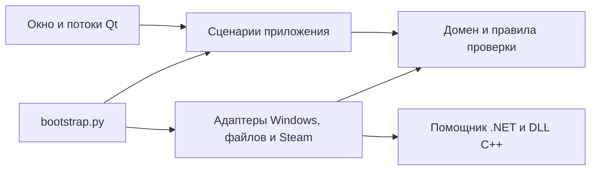

# Архитектура Steam SDA

Steam SDA — модульное настольное приложение. Сценарии аккаунтов используют переданные
им интерфейсы; реализации для Windows, файлов и Steam создаёт `steam_sda/bootstrap.py`.
Окно Qt получает готовый набор сервисов через конструктор.

```text
steam_sda/
  domain/                  Проверка аккаунтов, токенов, SteamID и HWID
  application/             Сценарии и контракты адаптеров
    accounts.py            Каталог, импорт, экспорт, настройки входа
    authentication.py      Обновление сессии и проверка владельца
    devices.py             Первая привязка HWID и применение профиля
    desktop.py             Наблюдение за Steam и решения для окна
    switching.py           Переключение Steam и восстановление
    sessions.py            Решения об автоматическом восстановлении
    preferences.py         Настройки и правила чтения кэша
    ports.py               Контракты хранилища, Steam и помощников
  infrastructure/
    persistence/           DPAPI, атомарная запись, vault, ZIP и maFile
    steam/                 Процессы Steam, реестр, VDF, кэш токена
    ipc/                   Приватные каналы к помощникам C# и C++
    community/             HTTP-запросы уровня Steam
    resources.py           Пути ресурсов исходников и готового EXE
  presentation/qt/         Окно, диалоги, виджеты и рабочие потоки Qt
  diagnostics/             Явная проверка с вымышленными аккаунтами
  bootstrap.py             Создание и связывание реализаций
  main.py                  Точка входа
integrations/
  steamkit/                Отдельный проект .NET
    Authentication/        SteamKit, Guard и соединение
    Identity/              Сохранённый профиль устройства
    Native/                Вызов нативного модуля и запуск процесса
  device/                  Отдельный проект CMake
    src/                   Сбор и применение профиля
    tests/                 Тестовый процесс без настоящего Steam
    third_party/minhook/   Зависимость с сохранённой лицензией
tests/                     Регрессионные тесты, сценарии и границы слоёв
tools/                     Сборка, упаковка и ручная проверка
```



`domain` зависит от стандартной библиотеки и собственных модулей. `application`
использует домен и контракты из `ports.py`; Qt, `requests`, `psutil`, WinAPI и
конкретные хранилища там не импортируются. Адаптеры реализуют контракты структурно,
без обратного импорта сценариев. Окно и диалоги собирают ввод и вызывают сервисы;
`workers.py` связывает их с потоками Qt.

Смена папок не меняет формат данных: `%APPDATA%\SteamSDA`, имена файлов DPAPI,
ключи профилей HWID и ZIP версии 1 сохранены. Импортировать аккаунты повторно
после обновления не требуется. Пути в упакованном приложении также прежние:
ресурсы находятся в `_internal/assets`, помощники — в `_internal/steamkit`.

Для нового внешнего API добавьте адаптер в `infrastructure`, передайте его
сценарию через `bootstrap.py` и проверьте сценарий с тестовой реализацией порта.
Изменение окна для этого не должно добавлять HTTP-запросы, работу с DPAPI или
запуск процессов в обработчики кнопок.

`tests/test_architecture.py` проверяет направления импортов и возможность загрузить
сценарии без Qt и адаптеров. Actions запускает эту проверку до сборки, затем
собирает C++, .NET и EXE, выполняет весь набор тестов и публикует ZIP с SHA-256.
