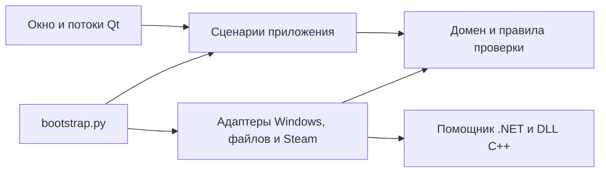

# Архитектура Steam SDA

Steam SDA — модульное настольное приложение. Сценарии аккаунтов используют переданные
им интерфейсы; реализации для Windows, файлов и Steam создаёт `steam_sda/bootstrap.py`.
Окно Qt получает готовый набор сервисов через конструктор.

```text
steam_sda/
  domain/                  Проверка аккаунтов, токенов, SteamID и HWID
  application/             Сценарии и контракты адаптеров
    accounts.py            Каталог, импорт, экспорт, настройки входа
    authentication.py      Обновление сессии и проверка владельца
    devices.py             Первая привязка HWID и применение профиля
    desktop.py             Наблюдение за Steam и решения для окна
    switching.py           Переключение Steam и восстановление
    sessions.py            Решения об автоматическом восстановлении
    preferences.py         Настройки и правила чтения кэша
    ports.py               Контракты хранилища, Steam и помощников
  infrastructure/
    persistence/           DPAPI, атомарная запись, vault, ZIP и maFile
    steam/                 Процессы Steam, реестр, VDF, кэш токена
    ipc/                   Приватные каналы к помощникам C# и C++
    community/             HTTP-запросы уровня Steam
    resources.py           Пути ресурсов исходников и готового EXE
  presentation/qt/         Окно, диалоги, виджеты и рабочие потоки Qt
  diagnostics/             Явная проверка с вымышленными аккаунтами
  bootstrap.py             Создание и связывание реализаций
  main.py                  Точка входа
integrations/
  steamkit/                Отдельный проект .NET
    Authentication/        SteamKit, Guard и соединение
    Identity/              Сохранённый профиль устройства
    Native/                Вызов нативного модуля и запуск процесса
  device/                  Отдельный проект CMake
    src/                   Сбор и применение профиля
    tests/                 Тестовый процесс без настоящего Steam
    third_party/minhook/   Зависимость с сохранённой лицензией
tests/                     Регрессионные тесты, сценарии и границы слоёв
tools/                     Сборка, упаковка и ручная проверка
```



`domain` зависит от стандартной библиотеки и собственных модулей. `application`
использует домен и контракты из `ports.py`; Qt, `requests`, `psutil`, WinAPI и
конкретные хранилища там не импортируются. Адаптеры реализуют контракты структурно,
без обратного импорта сценариев. Окно и диалоги собирают ввод и вызывают сервисы;
`workers.py` связывает их с потоками Qt.

Данные по-прежнему находятся в `%APPDATA%\SteamSDA`; имена файлов DPAPI,
ключи профилей HWID и ZIP версии 1 сохранены. Повторный импорт после обновления
не требуется. В защищённый vault добавлен список `_removed`: удаление одной
атомарной записью очищает данные аккаунта и запрещает повторное обнаружение
из списка Steam. Явный импорт снимает этот запрет. Старые хранилища читаются
без преобразования; старые версии приложения не понимают новый список удалений.

Общий ZIP содержит `accounts.json` с форматом `steam-sda-accounts`, версией 1 и
массивом аккаунтов. Чтение ограничено 6 МБ и 1000 записями. Валидация проверяет
владельцев токенов и уникальность логинов и SteamID; подготовка недостающих HWID
происходит до записи. `AccountVault.import_records` объединяет всю группу одной
записью DPAPI, сохраняя другие аккаунты и прежние профили. Старые `account.json`
и отдельные maFile по-прежнему принимаются. Пароли Steam не экспортируются.

Перед передачей клиентской сессии сценарий переключения записывает отдельное
соответствие логина и SteamID в `config.vdf/Software/Valve/Steam/Accounts`.
Журнал хранит прежнее и выбранное значения этой записи. При восстановлении
проверяется, что другая программа не изменила владельца; остальные поля
`config.vdf` не перезаписываются. Старые журналы без этой записи читаются.

Текущий вход без «Запомнить меня» может отсутствовать в `loginusers.vdf`.
Адаптер Steam добавляет его в каталог только при подтверждённом активном SteamID
и единственном соответствующем логине в `config.vdf/Software/Valve/Steam/Accounts`.
Отсутствующие данные входа не подменяются вымышленной записью.
Сценарий сохраняет доступный клиентский токен текущего разового входа при
обнаружении и перед закрытием Steam. Поле `session_origin` в защищённой записи
и ZIP фиксирует источник; старые записи без этого поля читаются. Статус сессии
определяется отдельно от флагов автоматического восстановления и сохранения
пароля Steam. Наличие только активного SteamID не означает наличие переносимого
токена. Отсутствие подходящего токена требует повторной авторизации владельца.

Структура готовой сборки соответствует назначению файлов:

```text
SteamSDA.exe                     Точка входа
layout.json                      Версия и карта компонентов
app/steam_sda/                   Код Python в .pyc
  domain/
  application/
  infrastructure/
  presentation/qt/
runtime/                         Интерпретатор, Qt и сторонние библиотеки
assets/                          Тема, шрифт и ресурсы
integrations/steamkit/            SteamSDA.Auth.exe
integrations/device/             SteamSDADevice.dll
docs/                            Документация
licenses/                        Лицензии зависимостей
```

PyInstaller собирает зависимости в `runtime`, а пакет приложения отдельно в `.pyc`.
Runtime hook добавляет `app` в путь импорта до запуска точки входа. Ресурсы
разрешаются относительно EXE, нативный модуль — относительно помощника .NET.
Каталог `_internal` не используется. Упаковщик проверяет `layout.json` и наличие
слоёв. Actions распаковывает ZIP вне checkout и проверяет, что окно загружено
из `app/steam_sda/presentation/qt/window.pyc`, а не из исходников рабочей папки.

Иконки Qt рисуются из локальных SVG. `ActionButton` рисует градиент, тень и
состояния наведения и нажатия, `TransitionStack` управляет появлением страниц.
Анимации короткие и прерываемые; диагностические проверки отключают их через
свойство приложения `animationsEnabled=False`. Список аккаунтов рисует delegate,
без отдельного дерева виджетов для каждой записи.

Для нового внешнего API добавьте адаптер в `infrastructure`, передайте его
сценарию через `bootstrap.py` и проверьте сценарий с тестовой реализацией порта.
Изменение окна для этого не должно добавлять HTTP-запросы, работу с DPAPI или
запуск процессов в обработчики кнопок.

`tests/test_architecture.py` проверяет направления импортов и возможность загрузить
сценарии без Qt и адаптеров. Actions запускает эту проверку до сборки, затем
собирает C++, .NET и EXE, выполняет весь набор тестов и публикует ZIP с SHA-256.
